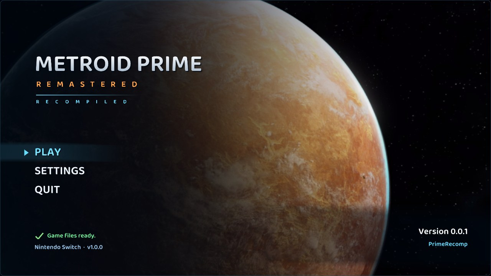
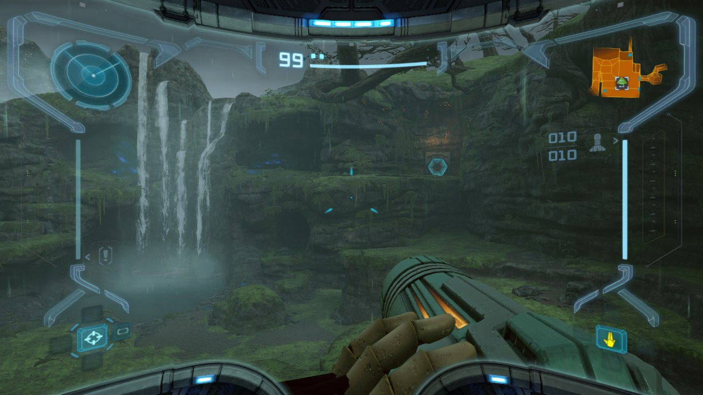

# PrimeRecomp

<a href="https://recomplauncher.com/game/primerecomp"><picture><source media="(prefers-color-scheme: dark)" srcset="https://recomplauncher.com/assets/press/launcher/badge-light.svg"></picture></a>

**PrimeRecomp** runs *Metroid Prime Remastered* (Nintendo Switch, 2023) natively on Windows, macOS (Apple Silicon) and
Linux, including the Steam Deck. The game's code is statically recompiled.

[discord]: https://discord.gg/TmWPy28wf

> [!NOTE]
> **No game files are included.** You need your own copy of Metroid Prime Remastered for Nintendo Switch,
> version 1.0.0 (no updates), dumped from your own console. Nothing from the game is in this repository or in the
> release downloads; the game is recompiled on your PC from your files the first time you set it up.

### Bug reporting; Feature requests

Please report bugs and request features on the [Issues tabs](https://github.com/gminustwo/primerecomp/issues). For a bug, these help the most:

- **Screenshots, a GIF or a short video** of the problem
- **The details:** what happened, what you were doing and where in the game, and your system (Windows, macOS, Linux or
  Steam Deck; CPU and GPU, or your Mac's model)
- **A copy of your save file:** zip up the `save` folder (Windows: in the PrimeRecomp folder; macOS:
  `~/Library/Application Support/io.github.primerecomp/save`; Linux and Steam Deck: `~/.local/share/primerecomp/save`)
- `primerecomp.log`, if you can, from the folder that holds `save`. It always holds the latest run, and
  `primerecomp.previous.log` the run before. It notes your settings and what you change, each room you enter and
  your items there, so it says where you were when something went wrong (nothing leaves your PC unless you send it).

For a graphics problem, you can also press **F9** at the spot: it saves a capture of that frame in
`build/f9_<frame>/` in that same folder (zip it up). **F8** notes your position in `positions.txt`.





## Features

- Mouse aim that turns and aims directly, as in a PC shooter; full keyboard, mouse and controller rebinding
- Any resolution up to 8K, AMD FSR 1 upscaling, SMAA anti-aliasing, anisotropic texture filtering
- HDR on HDR displays (scRGB or HDR10): the sun on the snow, lights, beam shots and explosions go past the
  brightness of white, up to your display's peak, while the rest of the picture looks as it always has (F1 menu,
  Video tab: HDR, peak brightness, paper white)
- Ultrawide and any aspect ratio, the HUD out at the screen's sides (or a 21:9 frame's, or the 16:9 middle);
  adjustable field of view, and the arm cannon's apart from it (it keeps its size at a wide view)
- 30, 60, 90 or 120 frames per second, at full game speed even when the frame rate drops; V-Sync on or off
- Steam Deck presets
- 5.1 and 7.1 surround sound: the game's own 5.1 mix, as a Switch plays it to a surround TV, on as many speakers as
  your output has (F1 menu, Audio tab: Speakers; Auto follows your sound settings, stereo on headphones)
- Gyro aiming with controllers that have one
- Wii Remote + Nunchuk: point at the screen to aim, with the buttons laid out like Metroid Prime: Trilogy (a Mayflash
  DolphinBar or the PC's Bluetooth; F1 menu, Controls tab: Wii Remote)
- Rumble with a strength setting, and HD rumble: the game's own two-tone vibration, as a Switch plays it, on a
  Switch Pro Controller or a single Joy-Con, and on a DualSense's haptics over USB (F1 menu, Audio tab)
- Stick dead zones, with a picture of where each stick rests, and flick stick: push the right stick out to face that
  way, turn it round to turn with it (F1 menu, Controls tab)
- The game's button prompts drawn for your controller - Xbox, PlayStation, Switch, keyboard and mouse or Wii Remote,
  following your bindings - in the game's own style (F1 menu, Controls tab: Button icons; Auto follows what you used
  last)
- Any cutscene skippable
- Suit colors (F1 menu, Gameplay tab): Samus' suit - all four of them - in your own colors for the helmet, the
  armor and the rest; recolored from your own game files as the suit loads, seen on the pause screen's Samus and in
  cutscenes
- Cheats (F1 menu, Cheats tab): infinite energy, missiles and power bombs, a hint timer that cuts the game's
  15-40 minute wait for a hint down to as little as a second, and L3 (keyboard: H) to show the next hint at once;
  Samus' upgrades set as you like - missiles, power bombs, energy tanks, suit, beams, visors, morph ball upgrades,
  artifacts - or all unlocked at once
- Shader pre-load (F1 menu, Video tab; on by default): the game's shaders built on the start screen - everything
  you've seen, and the shaders of the rest of the game that come with PrimeRecomp as a list (hashes and render
  settings only: their code is read from your own game files) - so nothing pops in or hitches the first time it's
  drawn, on a first visit too. The first start takes longer (B / Esc plays at once; the rest loads while you play)
- Emulator mods (F1 menu, Mods tab): mods made for Ryujinx / yuzu or a modded Switch - game file (RomFS) mods - in
  the `mods` folder, a folder each, unpacked as they come (`romfs` right inside, or an SD card's
  `atmosphere/contents/010012101468C000/romfs`); switched on and off and put in order in the Mods tab (the higher
  mod's file is used when two have the same one). Atmosphere cheat files in a mod's `cheats` folder
  (`67C9CA1428222752.txt`) are switched one by one in the Cheats tab; cheats that change memory work, those that
  change the game's code (compiled ahead of time here) can't, and code patches (`.ips`, `.pchtxt`) aren't used
- Texture mods (F1 menu, Mods tab): image files in the `mods` folder drawn in place of the game's textures -
  PNG of any size, or DDS (BC1-BC7) for big packs. Turn on Dump textures to get the game's textures, named the way
  `mods` wants them (`dump\textures\tex_<size>_<name>.png`): edit one and put it in `mods`. Made for Remastered's own
  textures: GameCube / Wii (Dolphin) packs don't fit its models

## Future work

- Adding VR support

## Requirements

- **Windows:** Windows 10 or 11, 64-bit
- **Linux:** a 64-bit x86 distribution with glibc 2.35 or newer (Ubuntu 22.04, Debian 12, Fedora 36, Arch, SteamOS
  on the Steam Deck, ...)
- On Windows and Linux, a CPU with SSE4.2 (2008 or newer; AVX2 - Intel Haswell / 2013, AMD Zen - runs the game faster:
  without it the game code is built for older CPUs) and a GPU with a Vulkan 1.3 driver (any current NVIDIA, AMD or Intel driver; on Linux, Mesa's RADV / ANV or NVIDIA's)
- Your own Metroid Prime Remastered v1.0.0 game files, **extracted**: a folder holding `exefs` and `romfs` (extract
  both from your own dump with your usual Switch tools). PrimeRecomp never asks for
  keys.

## Getting started

### Windows

1. Download `PrimeRecomp-v0.0.11-windows.zip` from [Releases](https://github.com/gminustwo/primerecomp/releases) and
   extract it somewhere you can write to (e.g. Documents or a games folder - not Program Files).
2. Run `primerecomp.exe`. The start screen asks for your game files: choose the folder that holds `exefs` and
   `romfs`, then **Set up**. It copies what it needs and recompiles the game on your PC. This happens once and takes
   several minutes.
3. Press **Play**.

Everything PrimeRecomp writes - game files, saves, settings (`primerecomp.ini`), logs - stays in its own folder, apart
from a short note of where that folder is (`%LOCALAPPDATA%\PrimeRecomp\copies.txt`) so that newer versions find it
([Updating](#updating)).

### macOS (Apple Silicon)

1. Download `PrimeRecomp-v0.0.11-macOS.dmg` from [Releases](https://github.com/gminustwo/primerecomp/releases), open
   it and drag **PrimeRecomp** onto **Applications**.
2. PrimeRecomp isn't notarized by Apple, so macOS won't open it as downloaded. Open Terminal once and run:

   ```
   xattr -dr com.apple.quarantine /Applications/PrimeRecomp.app
   ```

   This clears the "downloaded from the internet" mark from the app and from the tools inside it that recompile
   the game: without this, macOS stops them. Do it again after each update.
3. Open PrimeRecomp. The start screen works as on Windows: choose the folder that holds `exefs` and `romfs`,
   **Set up**, then **Play**.

Everything it writes goes to `~/Library/Application Support/io.github.primerecomp`. The first time each effect
appears, MoltenVK compiles its shader for Metal, which can show as a brief hitch. More in
[docs/macos.md](docs/macos.md).

### Linux

1. Download `PrimeRecomp-v0.0.11-linux-x86_64.AppImage` from
   [Releases](https://github.com/gminustwo/primerecomp/releases) and make it executable (`chmod +x`, or in your file
   manager: Properties -> Permissions -> executable).
2. Run it. The start screen works as on Windows: choose the folder that holds `exefs` and `romfs`, **Set up**,
   then **Play**.

Everything it writes goes to `~/.local/share/primerecomp`. If the AppImage won't start with a FUSE error, install
your distribution's `fuse3` package. More in [docs/linux.md](docs/linux.md).

### Steam Deck

1. In Desktop Mode, put the AppImage in your home folder (e.g. `~/Games/PrimeRecomp/`), right-click it ->
   Properties -> Permissions -> "Is executable", and copy your game files (the folder with `exefs` and `romfs`) onto
   the Deck or its SD card.
2. Run the AppImage, choose the game folder and **Set up** (once; it takes a while on the Deck).
   Do this in Desktop Mode: the file picker is a desktop file dialog.
3. Add it to Steam: Games -> Add a Non-Steam Game to My Library -> Browse (set the file type to "All Files") -> the
   AppImage. It then starts from Game Mode.
4. The first start on a Deck picks PrimeRecomp's **steady 30 fps** preset (1280 x 720, full game speed). PrimeRecomp's
   menu (press both sticks in) has it on the Video tab and a **60 fps** preset (960 x 540 scaled up with AMD FSR 1)
   under "Steam Deck" (pick one there after updating from v0.0.2); turn on **Show FPS** to see which one holds where
   you play.

The setup puts about 8 GB in `~/.local/share/primerecomp`; [docs/linux.md](docs/linux.md#steam-deck) shows how to
keep it on the SD card instead.

### Updating

From v0.0.8 on, the start screen checks for a new version and offers it: **UPDATE TO ...** under PLAY. On Windows
and with the AppImage (Linux, Steam Deck), **Update now** downloads and installs it in place - your shortcuts
(Steam, Playnite) keep working - and PrimeRecomp restarts by itself; on macOS it opens the download page. The check
only asks GitHub for the latest release; turn it off in Settings > Prelaunch (Check for updates).

### Saves from an emulator or a Switch

On the start screen, **Settings > Prelaunch > Import a save** lists the Metroid Prime Remastered saves that Ryujinx,
yuzu, suyu, Sudachi, Citron, Eden and torzu keep on this computer, latest first and with the emulator's profile name.
Choose one to play on from it. For a save backed up from a Switch (JKSV, Checkpoint) or a portable emulator, use
**Choose a folder...** and pick its folder. The save you had is kept: it's moved aside, and the same list shows it as
"Your save before an import" so you can go back to it.

### RecompLauncher

Release builds include a setup/settings/save profile for RecompLauncher: [`recomplauncher.json`](recomplauncher.json), a
plain file at the root of this repository. See [RecompLauncher integration](docs/recomplauncher.md) for the required launcher features, game inputs
and headless setup options. Linux keeps its standalone AppImage.

### Starting from a launcher (Playnite, Steam, ...)

Two arguments start PrimeRecomp without its start screen, for a game launcher's shortcut (Playnite: the game's
Actions; Steam: Properties -> Launch Options; the AppImage takes them too):

- `--play` goes straight into the game. With **Pre-load shaders** on (Video tab), the shaders load beside the game
  instead of before it.
- `--preload-shaders` builds the game's shaders first, with a progress bar (B / Esc: play at once), then starts the
  game - whether Pre-load shaders is on or not. Use it instead of `--play` for a first visit anywhere without
  hitches.

Until the game files are set up, both open the start screen as usual.

**PrimeRecomp's own menu** (graphics, controls, audio, quitting): **F1**, or on a controller both sticks pressed in
(or Back + Start). Fullscreen: F11 or Alt+Enter.

## Credits

### LAS Recomp

PrimeRecomp is a fork of [LAS Recomp](https://github.com/peiikai/LASRecomp) (MIT), starting from upstream commit
`b846e72`, and keeps its full history.

## Legal

PrimeRecomp is a fan project. It is not affiliated with, endorsed by or sponsored by Nintendo or Retro Studios.
*Metroid* and *Metroid Prime* are trademarks of Nintendo. No game files, game code, assets or fonts are included -
not in this repository and not in release builds. You must provide your own legally obtained copy of the game.

## License

PrimeRecomp's code - LAS Recomp's code and the changes made for Metroid Prime Remastered - is open source under the
[MIT License](LICENSE) (copyright Peiikai, and the PrimeRecomp contributors for their changes). Third-party
components keep their own licenses: Dear ImGui (MIT), Vulkan Memory Allocator (MIT), SMAA (MIT), AMD FSR 1 (MIT),
bcdec (MIT), miniz (MIT), code ported from Ryujinx (MIT), the Baloo 2 font (SIL OFL 1.1), SDL 3 (zlib), FFmpeg (LGPL 2.1+, linked
dynamically), shaderc (Apache 2.0), the Zig compiler (MIT; its LLVM / Clang / LLD: Apache 2.0 with LLVM exceptions;
its C library headers keep their own licenses) and the game code generator helper's bundled libraries listed above
(Unicorn is under the GPL: the helper is a separate program the setup runs, and its sources are this repository plus
Unicorn's published sources). The license covers PrimeRecomp's code only - it grants nothing for Nintendo's game,
which you must supply yourself.

### Source code of bundled third-party components

The Windows release includes these components; their source code for the exact versions shipped is available here:

| Component | Version | License | Source |
|---|---|---|---|
| FFmpeg (LGPL configuration: only the codecs the game's movies use) | 9.0.2 | LGPL 2.1+ | https://ffmpeg.org/releases/ |
| SDL 3 | 3.4.18 | zlib | https://github.com/libsdl-org/SDL/releases/tag/release-3.4.18 |
| shaderc (GLSL to SPIR-V) | 2026.4 | Apache 2.0 | https://github.com/google/shaderc |
| libiconv (used by SDL 3) | 1.19 | LGPL 2.1+ | https://ftp.gnu.org/pub/gnu/libiconv/libiconv-1.19.tar.gz |
| GCC runtime: libgcc, libstdc++ | 16.2.0 | GPL 3.0 with the GCC Runtime Library Exception | https://gcc.gnu.org/ |
| winpthreads (mingw-w64) | 14.0.0 | MIT / BSD | https://www.mingw-w64.org/ |
| Zig (builds the game code during setup; includes LLVM, Clang, LLD) | 0.17.0 | MIT; LLVM: Apache 2.0 with LLVM exceptions | https://ziglang.org/download/0.17.0/zig-0.17.0.tar.xz |
| PyInstaller (packs the game code generator) | 6.22.3 | GPL 2.0+ with bootloader exception | https://github.com/pyinstaller/pyinstaller/releases/tag/v6.22.3 |
| CPython (game code generator) | 3.12.10 | PSF | https://github.com/python/cpython/releases/tag/v3.12.10 |
| Capstone (game code generator) | 5.0.9 | BSD 3-clause | https://pypi.org/project/capstone/5.0.9/ |
| Unicorn (game code generator) | 2.1.4 | GPL 2.0 (Python bindings: BSD) | https://pypi.org/project/unicorn/2.1.4/, https://github.com/unicorn-engine/unicorn |
| python-lz4 (game code generator; includes LZ4) | 4.4.5 | BSD 3-clause; LZ4: BSD 2-clause | https://pypi.org/project/lz4/4.4.5/ |
| Baloo 2 font (SemiBold) | 1.640 | SIL OFL 1.1 | https://github.com/EkType/Baloo2 |
| SMAA (shader and lookup textures, built in) | 2013 (repository master) | MIT | https://github.com/iryoku/smaa |
| miniz (its inflater, built in) | 3.1.2 | MIT | https://github.com/richgel999/miniz |

The build scripts that fetch and build these (with checksums) are in this repository: `tools/build_deps_windows.sh`
and `tools/primegen.spec`. The Windows build takes SDL 3, shaderc, libiconv and the compiler runtime from MSYS2's
UCRT64 packages (https://packages.msys2.org, which links each package's source).

The Linux AppImage bundles the same components, built from pinned sources (with checksums) in an Ubuntu 22.04
container by `tools/linux/build_deps.sh` and `tools/linux/gen_helper.sh`, in these versions: FFmpeg 9.0.2 (the same
LGPL configuration), SDL 3 3.4.16 (https://github.com/libsdl-org/SDL/releases/tag/release-3.4.16), shaderc 2026.3
(https://github.com/google/shaderc/releases/tag/v2026.3), Zig 0.17.0, PyInstaller 6.22.3, CPython 3.12.15
(https://github.com/python/cpython/releases/tag/v3.12.15), Capstone 5.0.9, Unicorn 2.1.4, python-lz4 4.4.5 and the
Baloo 2 font; the other sources are linked in the table above. The C / C++ runtime (glibc, libstdc++), the Vulkan
loader and the GPU drivers are the system's and are not bundled.
