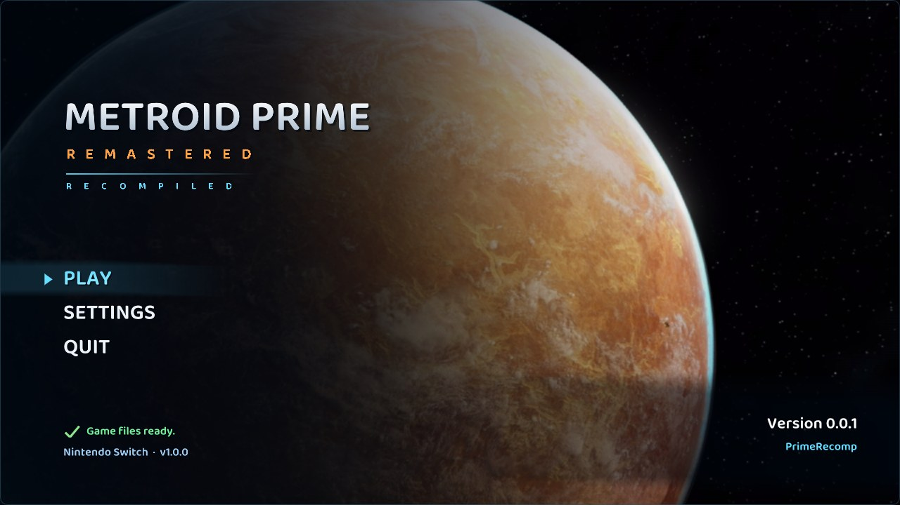
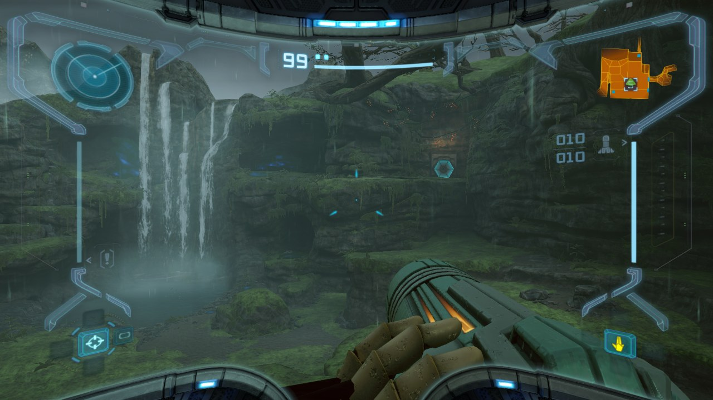

# PrimeRecomp

[](https://buymeacoffee.com/rengar)

**PrimeRecomp** runs *Metroid Prime Remastered* (Nintendo Switch, 2023) natively on Windows, macOS (Apple Silicon) and
Linux, including the Steam Deck. The game's code is statically recompiled - translated ahead of time from the Switch's
ARM64 code into C and compiled for your PC - and the Switch's system services and NVN graphics are reimplemented on the
PC, with Vulkan for the graphics. No emulator runs.

> [!IMPORTANT]
> **PrimeRecomp is built on [LAS Recomp](https://github.com/peiikai/LASRecomp) by
> [Peiikai](https://github.com/peiikai) and the LAS Recomp contributors.** LAS Recomp is the static recompilation of
> *The Legend of Zelda: Link's Awakening* for Switch, and nearly everything that makes PrimeRecomp possible is their
> work: the recompiler that turns Switch code into C, the Horizon OS kernel and services, the NVN-to-Vulkan renderer
> and shader translator, audio, input, the start screen, the in-game menu and the setup that builds the game on your
> own PC. PrimeRecomp adapts that work to Metroid Prime Remastered. Please star
> [LAS Recomp](https://github.com/peiikai/LASRecomp) too. Full credits are [below](#credits).

> [!NOTE]
> **No game files are included.** You need your own copy of Metroid Prime Remastered for Nintendo Switch,
> version 1.0.0 (no updates), dumped from your own console. Nothing from the game is in this repository or in the
> release downloads; the game is recompiled on your PC from your files the first time you set it up.





## Status: v0.0.4 (early beta)

The game boots, the Frigate Orpheon plays through, and Tallon IV is playable (the Landing Site, Chozo Ruins and
Magmoor Caverns have been played so far), with saving and loading. Areas nobody has reached yet may still crash or
freeze.

> [!WARNING]
> **Known issues.** Each one is crossed out here once it's fixed.
>
> - Steam Deck performance still isn't great, with major slowdowns when going through doors
> - Numerous graphics and rendering issues
> - Lighting issues persist
> - ~~Samus' character model doesn't render correctly on the pause screen~~
>
> Found something else? See [Bugs and feature requests](#bugs-and-feature-requests).

**New in v0.0.4: smoother doors.** Going through a door used to freeze the game for up to half a second while the
next room's textures were decoded on the CPU. They're now decoded on the graphics card, and lighting and texture
uploads no longer hold up the frame (the worst frame at a door on a fast PC: 293 ms before, under 20 ms now). Also
new: a V-Sync option (Video tab), and Samus' model on the pause screen is fixed.

**New in v0.0.3: Steam Deck performance.** v0.0.2 brought Linux and the Steam Deck; on the Deck it ran at about 25
fps. v0.0.3 removes the Linux-only costs behind that (the largest: how the game's memory was shared with the GPU, which
cost the Deck about 15 ms a frame), lets the CPU and GPU work at the same time, keeps the game at full speed when the
frame rate drops (it used to slow down with it), and adds Steam Deck presets (Video tab; a Deck starts with the steady
30 fps one) and a 30 fps option. Show FPS now also says whether the CPU or the GPU is the limit. The Linux version is
still experimental, so reports of how it goes are very welcome.

Also new: **macOS.** PrimeRecomp now comes as a Mac app for Apple Silicon ([macOS](#macos-apple-silicon)), with the same
Vulkan renderer on MoltenVK. And **updating no longer means setting up again.** A new version uses the game files, saves
and settings you already have ([Updating](#updating)).

### Still to do

- Fixing the remaining graphics bugs
- More testing of the Linux version on real hardware (the Steam Deck's performance first)
- An Android version

### Bugs and feature requests

Please report bugs and request features on the [PrimeRecomp Discord][discord] rather than as GitHub issues: it's much
easier to keep track of them there. For a bug, these help the most:

- **Screenshots, a GIF or a short video** of the problem
- **The details:** what happened, what you were doing and where in the game, and your system (Windows, macOS, Linux or
  Steam Deck; CPU and GPU, or your Mac's model)
- **A copy of your save file:** zip up the `save` folder (Windows: in the PrimeRecomp folder; macOS:
  `~/Library/Application Support/io.github.primerecomp/save`; Linux and Steam Deck: `~/.local/share/primerecomp/save`)
- `primerecomp.log`, if you can, from the folder that holds `save`. It always holds the latest run, and
  `primerecomp.previous.log` the run before.

For a graphics problem, you can also press **F9** at the spot: it saves a capture of that frame in
`build/f9_<frame>/` in that same folder (zip it up). **F8** notes your position in `positions.txt`.

[discord]: https://discord.gg/TmWPy28wf

## Requirements

- **Windows:** Windows 10 or 11, 64-bit
- **Linux:** a 64-bit x86 distribution with glibc 2.35 or newer (Ubuntu 22.04, Debian 12, Fedora 36, Arch, SteamOS
  on the Steam Deck, ...)
- On Windows and Linux, a CPU with AVX2 (Intel Haswell / 2013 or newer, AMD Zen or newer) and a GPU with a Vulkan
  1.3 driver (any current NVIDIA, AMD or Intel driver; on Linux, Mesa's RADV / ANV or NVIDIA's)
- **macOS:** a Mac with Apple Silicon (M1 or newer) and macOS 15 or newer (Intel Macs aren't supported)
- About 15 GB of free disk space (the game files are copied in, about 7 GB, plus the recompiled game)
- Your own Metroid Prime Remastered v1.0.0 game files, **extracted**: a folder holding `exefs` and `romfs`
  (extract both from your own dump with your usual Switch tools)

## Getting started

### Windows

1. Download `PrimeRecomp-v0.0.4-windows.zip` from [Releases](https://github.com/gminustwo/primerecomp/releases) and
   extract it somewhere you can write to (e.g. Documents or a games folder - not Program Files).
2. Run `primerecomp.exe`. The start screen asks for your game files: choose the folder that holds `exefs` and
   `romfs`, then **Set up**. It copies what it needs and recompiles the game on your PC. This happens once and
   takes several minutes.
3. Press **Play**.

Everything PrimeRecomp writes - game files, saves, settings (`primerecomp.ini`), logs - stays in its own folder, apart
from a short note of where that folder is (`%LOCALAPPDATA%\PrimeRecomp\copies.txt`) so that newer versions find it
([Updating](#updating)).

### macOS (Apple Silicon)

1. Download `PrimeRecomp-v0.0.3-macOS.dmg` from [Releases](https://github.com/gminustwo/primerecomp/releases), open
   it and drag **PrimeRecomp** onto **Applications**.
2. PrimeRecomp isn't notarized by Apple, so macOS won't open it as downloaded. Open Terminal once and run:

   ```
   xattr -dr com.apple.quarantine /Applications/PrimeRecomp.app
   ```

   This clears the "downloaded from the internet" mark from the app and from the tools inside it that recompile
   the game: without this, macOS stops them. Do it again after each update.
3. Open PrimeRecomp. The start screen works as on Windows: choose the folder that holds `exefs` and `romfs`,
   **Set up**, then **Play**.

Everything it writes goes to `~/Library/Application Support/io.github.primerecomp`. The first time each effect
appears, MoltenVK compiles its shader for Metal, which can show as a brief hitch. More in
[docs/macos.md](docs/macos.md).

### Linux

1. Download `PrimeRecomp-v0.0.4-linux-x86_64.AppImage` from
   [Releases](https://github.com/gminustwo/primerecomp/releases) and make it executable (`chmod +x`, or in your file
   manager: Properties -> Permissions -> executable).
2. Run it. The start screen works as on Windows: choose the folder that holds `exefs` and `romfs`, **Set up**, then
   **Play**.

Everything it writes goes to `~/.local/share/primerecomp`. If the AppImage won't start with a FUSE error, install
your distribution's `fuse3` package. More in [docs/linux.md](docs/linux.md).

### Steam Deck

1. In Desktop Mode, put the AppImage in your home folder (e.g. `~/Games/PrimeRecomp/`), right-click it ->
   Properties -> Permissions -> "Is executable", and copy your game files (the folder with `exefs` and `romfs`) onto
   the Deck or its SD card.
2. Run the AppImage, choose the game folder and **Set up** (once; it takes a while on the Deck). Do this in Desktop
   Mode: the folder picker is a desktop file dialog.
3. Add it to Steam: Games -> Add a Non-Steam Game to My Library -> Browse (set the file type to "All Files") -> the
   AppImage. It then starts from Game Mode.
4. In the game, press both sticks in to open PrimeRecomp's menu and set Controls -> Face buttons to **Xbox**, so the
   Deck's A button is A.
5. The first start on a Deck picks PrimeRecomp's **steady 30 fps** preset (1280 x 720, full game speed). The menu's
   Video tab has it and a **60 fps** preset (960 x 540 scaled up with AMD FSR 1) under "Steam Deck" (pick one there
   after updating from v0.0.2); turn on **Show FPS** to see which one holds where you play.

The setup puts about 15 GB in `~/.local/share/primerecomp`; [docs/linux.md](docs/linux.md#steam-deck) shows how to
keep it on the SD card instead.

### Updating

A new version doesn't need your game files again, and keeps your saves and settings:

- **Windows:** extract the new zip anywhere, as you did the first time, and run it. In a new folder it finds your
  earlier copy (v0.0.3 or newer) by itself and uses its game files, saves and settings. The game files aren't copied
  again: on the same drive both copies share them, so the update takes no extra space, and you can delete the old
  folder afterwards. Extracting the new zip over your old PrimeRecomp folder (replacing the files) works too.
  **From v0.0.2 into a new folder:** on the start screen, choose your old PrimeRecomp folder as the game files
  folder; it's used the same way (your saves come along, your settings don't).
- **macOS:** drag the new PrimeRecomp onto Applications (replace the old one) and run the `xattr` command from
  [macOS](#macos-apple-silicon) again. Your game files, saves and settings stay in
  `~/Library/Application Support/io.github.primerecomp`.
- **Linux and Steam Deck:** replace the AppImage with the new one. Your game files, saves and settings stay in
  `~/.local/share/primerecomp`. On the Deck, give the new file the old one's name, or point the Steam shortcut at
  the new file (Properties -> Target).

When a new version changes how the game is recompiled, the start screen recompiles it once by itself the first time
you start the new version (several minutes; longer on a Steam Deck). Nothing needs to be chosen or set up again.

## Controls

A controller works out of the box (Xbox, PlayStation, Switch Pro, Steam Controller, Steam Deck and others), using
the game's own Dual Stick layout. The face buttons follow the Switch's layout (A on the right) until you switch
PrimeRecomp's menu -> Controls -> Face buttons to Xbox (A at the bottom). With a controller that has a gyro you
can use the game's Pointer / Hybrid motion aiming (pause, Options -> Controls -> Control Scheme).

Keyboard and mouse play like a PC shooter:

| | |
|---|---|
| Move | WASD |
| Aim / turn | Mouse (sensitivity and invert in PrimeRecomp's menu, Controls tab) |
| Shoot (hold: charge) | Left click |
| Lock on / scan (hold) | Right click |
| Jump | Space |
| Missile | F |
| Morph Ball | Left Ctrl |
| Visors: Combat / Scan / Thermal / X-Ray | Q / E / R / T |
| Beams: Power / Wave / Ice / Plasma | 1 / 2 / 3 / 4 |
| Map | Tab |
| Pause menu | Esc |

In the game's menus Enter / Space confirm, Esc goes back and Q / E switch pages. Everything can be rebound.

**PrimeRecomp's own menu** (graphics, controls, audio, quitting): **F1**, or on a controller both sticks pressed in
(or Back + Start). Fullscreen: F11 or Alt+Enter.

## Features

- Mouse aim that turns and aims directly, as in a PC shooter; full keyboard, mouse and controller rebinding
- Any resolution up to 8K, AMD FSR 1 upscaling, SMAA anti-aliasing, anisotropic texture filtering
- Ultrawide and any aspect ratio, the HUD out at the screen's sides (or a 21:9 frame's, or the 16:9 middle);
  adjustable field of view
- 30, 60 or 120 frames per second, at full game speed even when the frame rate drops; V-Sync on or off
- Steam Deck presets
- Gyro aiming with controllers that have one, rumble
- Any cutscene skippable

## Support PrimeRecomp

If you enjoy PrimeRecomp, you can support its development by
[buying me a coffee](https://buymeacoffee.com/rengar). Bug reports and a star for this repository and for
[LAS Recomp](https://github.com/peiikai/LASRecomp) help too.

## Building from source

See [docs/BUILD-windows.md](docs/BUILD-windows.md). In short: `tools\setup_windows.ps1` installs MSYS2 and the
tools; with your own extracted game files in `extracted/`, `make gen` recompiles the game and `make` builds
`build/primerecomp.exe`. `make dist` packages a release. Linux: see [docs/linux.md](docs/linux.md) - `make appimage`
builds the AppImage in an Ubuntu 22.04 container (from Windows, that works inside WSL2). macOS (Apple Silicon): see
[docs/macos.md](docs/macos.md) - `make deps`, `make gen-helper` and `tools/fetch_zig.sh` once, then `make app` builds
`build/PrimeRecomp.app`, the same Vulkan renderer on MoltenVK, and `make dmg` the release disk image.

Developer notes: [PROGRESS.md](PROGRESS.md) (history) and [HANDOFF.md](HANDOFF.md) (current state). Link's
Awakening's game code (its patches, its memory hooks, the randomizer, cheats and cosmetics) has been removed; LAS
Recomp's developer names (the `LARECOMP_*` test variables, some internal symbols) are kept on purpose, so fixes
still move between the two projects easily.

## Credits

### LAS Recomp

PrimeRecomp is a fork of [LAS Recomp](https://github.com/peiikai/LASRecomp) (MIT), starting from upstream commit
`b846e72`, and keeps its full history.

- **[Peiikai](https://github.com/peiikai)** - created LAS Recomp and wrote the great majority of it: the static
  recompiler and its ARM64 lifter, the Horizon kernel and system services, the NVN graphics layer and its Vulkan
  and Metal renderers, the Maxwell shader translator, audio, input and rumble, saves, the start screen and the
  in-game menu, and the on-PC setup that recompiles the game from the player's own files.

**LAS Recomp contributors** - code they sent to LAS Recomp lives on in PrimeRecomp. In LAS Recomp's own words
(GitHub handles, in order of first contribution):
- **[@dvilelaf](https://github.com/dvilelaf)** - the System language setting (#15), packaging fix for the game code
  generator helper (#10), and the task forwarder fix for the level-transition crash (#34, issue #19)
- **[@Tensorlong](https://github.com/Tensorlong)** - Metal half-precision fix for the white Link on M1 Macs (#18)
- **[@mansarip](https://github.com/mansarip)** - support for unrecognised controllers through a simple mapping file (#26)
- **[@we11adam](https://github.com/we11adam)** - shared fonts served per language instead of one Japanese font (#27),
  and the zh-Hans / zh-Hant codes for Chinese (#25)
- **[@Maganra](https://github.com/Maganra)** - Linux page write tracking (userfaultfd + PAGEMAP_SCAN) for the Vulkan
  vertex cache and texture checks (#42)
- **[@hjqcan](https://github.com/hjqcan)** - centralized game patch and runtime addresses (#57); CRLF settings
  parsing and Traditional Chinese locale detection (#53); Windows game thread stacks reserved instead of committed,
  about 9 GB less memory committed (#107); the Vulkan fence fix for reused submission slots (#108); x86 rounding
  without x87 state changes (#115); movie memory freed on close, source change and reboot (#112); Vulkan stopping
  cleanly on GPU timeouts (#127); a strict Vulkan validation mode for automated tests (#128); Windows session logs
  (#114); resumable game-code builds: a cancelled or interrupted setup picks up where it stopped (#56); randomizer
  check flags kept with committed saves (#170); save write fixes that keep a failed save from losing data (#169,
  merged in #182)
- **[@gitarre1234rr5](https://github.com/gitarre1234rr5)** - controller rumble: the game's vibration on your
  controller (#104), and a regression test for the kernel's timed condition-variable wait (#88)
- **[@rkammoun](https://github.com/rkammoun)** - diagnosed and patched the Metal 16-sampler limit behind the black
  walls in the Ukuku Prairie cave (#215, fixed in #216)

Thanks also to everyone who reported issues and tested LAS Recomp builds, and to
[Dusklight](https://github.com/TwilitRealm/dusklight) by the TwilitRealm team, which inspired LAS Recomp's start
screen.

### Other projects

- [Ryujinx](https://github.com/Ryujinx/Ryujinx) (MIT) - PrimeRecomp's audio effects (reverb, I3DL2 reverb, delay,
  aux, splitters) are ported from Ryujinx's audio renderer, and some shader instruction decoding follows its decoders
- [envytools](https://github.com/envytools/envytools) - NVIDIA GPU documentation used for the shader translator
- [Switchbrew](https://switchbrew.org) and the Switch homebrew and emulation communities' documentation

### Libraries and tools

- [SDL 3](https://libsdl.org) - windowing, input, audio (zlib license)
- [FFmpeg](https://ffmpeg.org) - movie playback (LGPL)
- [Dear ImGui](https://github.com/ocornut/imgui) - the in-game menu and start screen (MIT)
- [Baloo 2](https://github.com/EkType/Baloo2) by Ek Type - the start screen's font (SIL Open Font License 1.1,
  `third_party/fonts/Baloo2/OFL.txt`)
- [Vulkan Memory Allocator](https://github.com/GPUOpen-LibrariesAndSDKs/VulkanMemoryAllocator) - the renderer (MIT)
- [SMAA](https://github.com/iryoku/smaa) by Jorge Jimenez, Jose I. Echevarria, Belen Masia, Fernando Navarro and
  Diego Gutierrez - the anti-aliasing option (MIT, `third_party/smaa/LICENSE.txt`)
- [AMD FidelityFX Super Resolution 1](https://github.com/GPUOpen-Effects/FidelityFX-FSR) - the upscaler option,
  ported to GLSL (MIT)
- [shaderc](https://github.com/google/shaderc) - GLSL to SPIR-V (Apache 2.0)
- [Zig](https://ziglang.org) - its C compiler (`zig cc`: Clang and LLD) builds the game code on your PC during setup
  (MIT; LLVM, Clang, LLD: Apache 2.0 with LLVM exceptions)
- The game code generator (`tools/gen.py`) is packed by [PyInstaller](https://pyinstaller.org) (GPL 2.0+ with the
  bootloader exception) into a standalone helper. It bundles CPython (PSF License),
  [Capstone](https://www.capstone-engine.org) (BSD 3-clause; disassembly), [Unicorn](https://www.unicorn-engine.org)
  (GPL 2.0; Python bindings BSD; resolves jump tables) and [python-lz4](https://github.com/python-lz4/python-lz4)
  (BSD 3-clause, with LZ4: BSD 2-clause)

## Legal

PrimeRecomp is a fan project. It is not affiliated with, endorsed by or sponsored by Nintendo or Retro Studios.
*Metroid* and *Metroid Prime* are trademarks of Nintendo. No game files, game code, assets or fonts are included -
not in this repository and not in release builds. You must provide your own legally obtained copy of the game.

## License

PrimeRecomp's code - LAS Recomp's code and the changes made for Metroid Prime Remastered - is open source under the
[MIT License](LICENSE) (copyright Peiikai, and the PrimeRecomp contributors for their changes). Third-party
components keep their own licenses: Dear ImGui (MIT), Vulkan Memory Allocator (MIT), SMAA (MIT), AMD FSR 1 (MIT),
code ported from Ryujinx (MIT), the Baloo 2 font (SIL OFL 1.1), SDL 3 (zlib), FFmpeg (LGPL 2.1+, linked
dynamically), shaderc (Apache 2.0), the Zig compiler (MIT; its LLVM / Clang / LLD: Apache 2.0 with LLVM exceptions;
its C library headers keep their own licenses) and the game code generator helper's bundled libraries listed above
(Unicorn is under the GPL: the helper is a separate program the setup runs, and its sources are this repository plus
Unicorn's published sources). The license covers PrimeRecomp's code only - it grants nothing for Nintendo's game,
which you must supply yourself.

### Source code of bundled third-party components

The Windows release includes these components; their source code for the exact versions shipped is available here:

| Component | Version | License | Source |
|---|---|---|---|
| FFmpeg (LGPL configuration: only the codecs the game's movies use) | 9.0.2 | LGPL 2.1+ | https://ffmpeg.org/releases/ |
| SDL 3 | 3.4.18 | zlib | https://github.com/libsdl-org/SDL/releases/tag/release-3.4.18 |
| shaderc (GLSL to SPIR-V) | 2026.4 | Apache 2.0 | https://github.com/google/shaderc |
| libiconv (used by SDL 3) | 1.19 | LGPL 2.1+ | https://ftp.gnu.org/pub/gnu/libiconv/libiconv-1.19.tar.gz |
| GCC runtime: libgcc, libstdc++ | 16.2.0 | GPL 3.0 with the GCC Runtime Library Exception | https://gcc.gnu.org/ |
| winpthreads (mingw-w64) | 14.0.0 | MIT / BSD | https://www.mingw-w64.org/ |
| Zig (builds the game code during setup; includes LLVM, Clang, LLD) | 0.17.0 | MIT; LLVM: Apache 2.0 with LLVM exceptions | https://ziglang.org/download/0.17.0/zig-0.17.0.tar.xz |
| PyInstaller (packs the game code generator) | 6.22.3 | GPL 2.0+ with bootloader exception | https://github.com/pyinstaller/pyinstaller/releases/tag/v6.22.3 |
| CPython (game code generator) | 3.12.10 | PSF | https://github.com/python/cpython/releases/tag/v3.12.10 |
| Capstone (game code generator) | 5.0.9 | BSD 3-clause | https://pypi.org/project/capstone/5.0.9/ |
| Unicorn (game code generator) | 2.1.4 | GPL 2.0 (Python bindings: BSD) | https://pypi.org/project/unicorn/2.1.4/, https://github.com/unicorn-engine/unicorn |
| python-lz4 (game code generator; includes LZ4) | 4.4.5 | BSD 3-clause; LZ4: BSD 2-clause | https://pypi.org/project/lz4/4.4.5/ |
| Baloo 2 font (SemiBold) | 1.640 | SIL OFL 1.1 | https://github.com/EkType/Baloo2 |
| SMAA (shader and lookup textures, built in) | 2013 (repository master) | MIT | https://github.com/iryoku/smaa |

The build scripts that fetch and build these (with checksums) are in this repository: `tools/build_deps_windows.sh`
and `tools/primegen.spec`. The Windows build takes SDL 3, shaderc, libiconv and the compiler runtime from MSYS2's
UCRT64 packages (https://packages.msys2.org, which links each package's source).

The Linux AppImage bundles the same components, built from pinned sources (with checksums) in an Ubuntu 22.04
container by `tools/linux/build_deps.sh` and `tools/linux/gen_helper.sh`, in these versions: FFmpeg 9.0.2 (the same
LGPL configuration), SDL 3 3.4.16 (https://github.com/libsdl-org/SDL/releases/tag/release-3.4.16), shaderc 2026.3
(https://github.com/google/shaderc/releases/tag/v2026.3), Zig 0.17.0, PyInstaller 6.22.3, CPython 3.12.15
(https://github.com/python/cpython/releases/tag/v3.12.15), Capstone 5.0.9, Unicorn 2.1.4, python-lz4 4.4.5 and the
Baloo 2 font; the other sources are linked in the table above. The C / C++ runtime (glibc, libstdc++), the Vulkan
loader and the GPU drivers are the system's and are not bundled.
